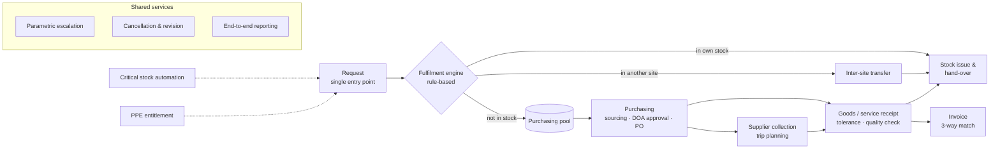
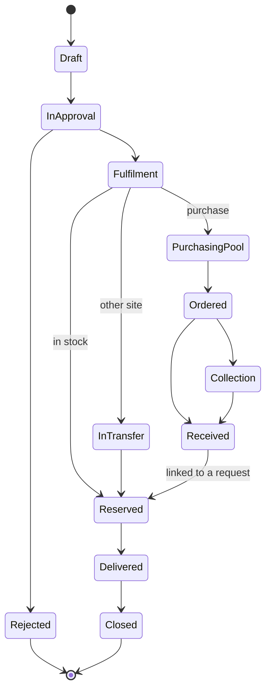

# Procure-to-Pay Redesign: Case Study

How I redesigned the request → stock → transfer → purchasing → receipt → invoice cycle of a
multi-site industrial company as **one module** on its BPM platform, integrated with the ERP.

> This is a generalized description of the design. It contains no company data, system names,
> people, internal identifiers or measurements. Approval counts are **by design**; the module was built
> and tested in a test environment.

---

## 1. The challenge

Procure-to-pay cycles in multi-site companies tend to grow process by process: a workflow for
requests, another for warehouse issues, another for purchasing, each added when it was needed.
The redesign set out to address the typical consequences of that growth:

| Challenge | Goal of the redesign |
|---|---|
| Work tracked per document and per step rather than per need | One request, one end-to-end status per line |
| Fulfilment decisions (stock, transfer or purchase) made by hand | Rule-based decisions with stock reservation |
| Approvals added over time without a common logic | One need approval and one spend approval, driven by authority tables |
| Routing that depends on specific people | Role- and org-chart-based assignment with fallback and delegation |
| ERP documents created as separate manual tasks | ERP postings generated by integration |
| Waiting time that is hard to see | SLAs, escalation and a flow board for every step |

## 2. Design principles

1. **One request, one process.** Lines travel as rows; every line has one status the requester can see.
2. **Let rules decide, let people handle exceptions.** A fulfilment engine decides stock / transfer / purchase and reserves stock.
3. **Approve the need once, approve the spend once.** The request gate validates need; the purchasing gate validates spend under a delegation-of-authority (DOA) table. The same person never approves both.
4. **No hard-coded people.** Every assignee is resolved from the org chart, a role table or a form field, with a defined fallback and delegation rules.
5. **The ERP document is a by-product, not a task.** Issue slips, transfers, purchase orders and goods receipts are posted by integration when the business step completes.
6. **Every wait has an owner and a clock.** SLAs and escalation are parameters the process owner edits without code changes.
7. **Model first.** A single JSON model holds sub-processes, steps, rules, RACI and decision tables. It is validated and **generates** the BPMN maps and the design document, so documentation never drifts from the design.

## 3. Module architecture

| Sub-process | Purpose |
|---|---|
| Request | One form, one manager approval; technical review only for items flagged as needing it |
| Fulfilment engine | Decide stock / transfer / purchase per line, reserve stock with expiry |
| Stock issue | Hand-over with partial delivery; ERP issue slip posted on confirmation |
| Inter-site transfer | Traceable two-step transfer through an "in transit" location; extra approval only above a value threshold |
| Purchasing | Pull from pool, quote or direct buy, DOA-based approval chain, ERP purchase order created automatically |
| Supplier collection | Trip plan and signed hand-over for goods we pick up ourselves |
| Goods / service receipt | Receipt against PO line with configurable tolerance; quality check where required; ERP receipt posted automatically |
| Invoice | Automatic 3-way match (PO ↔ receipt ↔ invoice); matched invoices post without human approval, mismatches go to an exception queue |
| Critical stock automation | Daily job creates requests when net stock falls below the critical level |
| PPE entitlement | Monthly personal protective equipment allowance by job role; within-allowance requests need no approval |
| Cancellation & revision | One approved, line-level cancellation path replacing several unapproved shortcuts |
| Parametric escalation | Reminder → manager → reassignment rules, editable by the process owner |
| End-to-end reporting | Where each line is, with whom, for how long; flow board by stage × ageing |

## 4. Results by design

Approval touches per scenario in the To-Be design:

| Scenario | Approval touches |
|---|---|
| Item in own warehouse | 2 |
| Item in another site (transfer) | 3 |
| Purchased stock item | 5–8, depending on order value |
| Service purchase | 4–6 |
| Critical stock replenishment | 2 (request is created automatically) |
| PPE within allowance | 1 |

Other outcomes by design:
- **Zero manual ERP entry** for issue slips, transfers, purchase orders and goods receipts.
- **No hard-coded approvers.** Every assignment is resolved from roles, the org chart or the DOA table.
- **Stock reservation**, so the same stock is never promised twice.
- **Single status model** for every line:

## 5. Decision tables (examples)

Thresholds are parameters in definition tables; the values below are illustrative.

**Fulfilment**

| Condition | Result | Human touch |
|---|---|---|
| Line is a service | Purchasing pool | None |
| Own-site available stock ≥ need | Reserve all → stock issue | Only at hand-over |
| Own stock partial, other sites have the rest | Reserve own + transfer proposal | Sending site confirms |
| Not enough anywhere | Purchasing pool for the shortfall | None |

**Delegation of authority (spend approval)**

| Order total | Approval levels |
|---|---|
| ≤ T1 | Purchasing manager |
| T1 – T2 | Purchasing manager → budget owner |
| > T2 | Purchasing manager → budget owner → executive |

**Critical stock**

| Parameter | Rule |
|---|---|
| Net level | ERP balance + open orders + in-transit transfers − reservations |
| Trigger | Net ≤ critical level and no open automatic request for the same item × site |
| Proposal | Top up to the maximum level; optionally check other sites' surplus first |

**Receipt and invoice tolerance**

| Check | Tolerance | When exceeded |
|---|---|---|
| Received qty vs open PO qty | +X % by category | Buyer decides |
| Invoice unit price vs PO | ± Y % or ± fixed amount | Exception queue |
| Invoice qty vs received qty | Cannot exceed | Exception queue |

## 6. Controls built in

| Risk | Control |
|---|---|
| Requester approves own need or spend | Approver resolution skips the requester; need and spend gates require different people |
| Spend above authority | DOA table drives the chain; no manual "add approver" that bypasses levels |
| Duplicate receipt or invoice | Supplier + document number unique; open quantity accounts for pending receipts |
| Payment without delivery | Invoice posts only when PO, receipt and invoice match within tolerance |
| Unreviewed cancellation | Single cancellation path with approval, at line level; ERP and workflow updated in one transaction |
| Silent delays | Every human step has an SLA, a reminder, an escalation and a fallback assignee |
| Stale reservations | Reservation expiry with notification to requester and warehouse |

RACI is defined per sub-process (Responsible, Accountable, Consulted, Informed) for 11 roles, and
generated into the design document from the same model.

## 7. Method

1. **Discover:** extract As-Is flows, assignment rules and embedded code from the platform's process
   packages instead of interviewing from memory. See
   [process-mapping-toolkit](https://github.com/Dogukanyllmaz/process-mapping-toolkit) for the control checks.
2. **Measure:** step-level waiting times from workflow history (working-day calendar, open items included).
3. **Redesign:** model-first JSON → validated → BPMN swimlane maps (L1 value chain plus one lane diagram per
   sub-process, status machine, before/after comparison) and an interactive design document.
4. **Build:** workflow packages generated for the test environment, with automated checks on the generated code.
5. **Integrate:** ERP postings through an idempotent sync service. See
   [bpm-erp-integration-pattern](https://github.com/Dogukanyllmaz/bpm-erp-integration-pattern).
6. **Run:** visual management board (stage × ageing, WIP in the purchasing pool, cycle-time trend,
   rejection / revision Pareto) for daily follow-up.

---

*Tools: BPMN 2.0 · draw.io · JSON model + Python generator · BPM platform (C# server code, SQL) · ERP integration · Lean (single-piece flow, pull from pool, visual management)*
